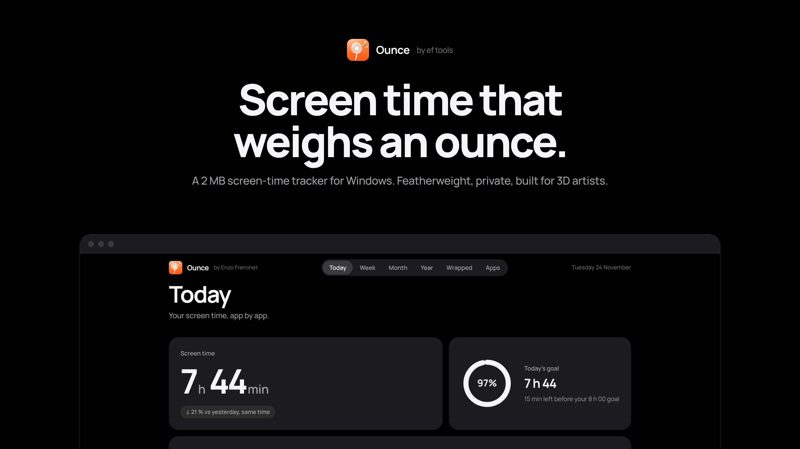

# Ounce

*by Enzo Freminet · ef tools*



**Screen time that weighs an ounce.**

Ounce shows how much time you really spend on your PC, and in which apps: a wellbeing dashboard, a weekly **Wrapped** and time per project for 3D artists (Maya, Blender, Houdini…). And it is built to weigh nothing.

## Featherweight

| | |
|---|---|
| **~2 MB** | One `.exe`. No installer, no runtime, no framework, no dependencies. |
| **~16 MB of memory** | Working set measured on Windows by the build's selftest. |
| **~0.2 % of one CPU core** | Measured over the selftest's 16 s, *including* startup (database, icons, update check). Running, it is lower. |
| **0 when idle** | Between two glances the thread sleeps; the tray and the dashboard wait for Windows events and use no CPU at all. |
| **1 glance every 2 s** | Two questions to Windows (foreground window, last input), a few microseconds, at "below normal" priority with EcoQoS on Windows 11. |
| **No hooks** | No keyboard or mouse hook, no screen capture, no GPU, no background browser. The window is opened only when you ask, and closing it frees it entirely. |

Measurements come from the Windows machine that builds each release (see the *Selftest* step of the Actions run); check yours in Task Manager. No telemetry: the dashboard only listens on `127.0.0.1`, and the only outgoing request is the daily update check (can be turned off). Your data stays with you: `%APPDATA%\Ounce\activity.db` (SQLite).

## Download

**[Download the latest version](https://github.com/bruce333-creator/ounce/releases/latest/download/ounce.exe)** (or see [all releases](https://github.com/bruce333-creator/ounce/releases)).

Double-click it, straight from your Downloads folder. Ounce **installs itself**: it copies itself to `%LOCALAPPDATA%\Programs\Ounce\` (your account only, no admin rights), adds **Ounce** to the Start menu and to *Settings → Apps*, then starts from there. You can delete the downloaded file afterwards. Your settings (`config.toml`) live next to the installed exe.

Coming from an older version kept in a folder of your own? Launch it once: it moves itself to the same place, keeps your history and settings, and points *Run at Windows startup* at the new location.

**Uninstall**: *Settings → Apps → Ounce → Uninstall*. Ounce asks whether to delete your history too (`ounce.exe --uninstall --quiet` uninstalls without asking and keeps it).

> The exe is not signed: on first launch Windows SmartScreen may say "Windows protected your PC". Click **More info** → **Run anyway**. See [SmartScreen and antivirus](#smartscreen-and-antivirus).

## Updating

**Automatic** (from 0.5 on): once a day, Ounce checks GitHub for a newer version. If there is one:

- an "Update X available" notification appears: **click it** to install;
- or right-click the tray icon → **Install update X**;
- or the **Install** button in the banner at the top of the window.

The app downloads the new exe, swaps it with the old one and restarts by itself (a few seconds). Nothing is installed without your click. Your data, settings, names and logos are kept. To turn the check off: `check_updates = false`.

**Coming from Activity Tracker** (the former name, 0.5 and earlier): the update installs Ounce in place and moves your data from `%APPDATA%\ActivityTracker` to `%APPDATA%\Ounce` on first start. Nothing to do.

**By hand** (0.4 and earlier, or if the exe sits in a protected folder such as `C:\Program Files`):

1. Right-click the tray icon → **Quit**. This saves the current session.
2. Replace the old `ounce.exe` with the new one, **in the same folder** and with the same name.
3. Double-click the new exe.

Your data (history, custom names and logos) lives in `%APPDATA%\Ounce\` and is never touched by an update. Autostart keeps working since the exe path does not change. The installed version is shown at the bottom of the window and in the exe's Properties → Details.

## Usage

Double-click `ounce.exe`. The logo (white clock on black) appears in the notification area; it may be hidden under the ^ arrow. Drag it onto the taskbar to keep it visible.

- **Left click**: opens Ounce in its own window.
- **Right click**: *Open Ounce*, *Weekly Wrapped*, *Pause / Resume tracking* (the icon turns grey), *Run at Windows startup* (checkbox), *Show on the taskbar* (checkbox), *Edit settings…* (opens `config.toml` in Notepad), *Quit*.

Everything is in English. A French translation is available with `language = "fr"`.

Launching the exe while it is already running just opens the window (one instance at a time). If the running copy comes from **another exe** (an older download, or the one started with Windows), it saves its session and closes, and the exe you launched takes over; autostart then points to the new exe.

### The window

The interface opens in an **app window** (Microsoft Edge "app" mode, present on every Windows 10/11: no tabs, no address bar). It uses its own Edge profile (in the data folder), so your browser never reopens it by itself and your extensions stay out of it. It costs nothing while closed and does not grow the exe. Without Edge, the page opens in the default browser at `http://127.0.0.1:8765/`.

- **Today / Week / Month**:
  - screen time compared with the same previous period (yesterday at the same hour, etc.);
  - goal ring;
  - day timeline and bars per hour or per day;
  - apps with **their real icon** and the change per app ("+1 h 20", "−35 min");
  - **projects** (see below);
  - **wellbeing**: breaks, longest stretch without a break, start and end of the day, time after 11 pm;
  - **focus**: longest run in a single app, app switches per hour;
  - **per-app limits**.
- **Year**: a calendar (one square per day, brighter = more time), the **creative streak** (days in a row with at least 30 min in your creative apps), the **under-goal streak**, the record day and the average.
- **Wrapped**: your profile of the week (Marathoner, Night Owl, Early Bird, Loyal to Maya, Deep Focus, Zen, Balanced…), total and trend, #1 app, top 5, your projects, what went up or down, busiest day and peak hour. **Share image** downloads a 1080×1350 picture ready for social media.
- **Export CSV** (bottom of the page): every session (start, end, minutes, app, process, project), to open in Excel.

The page refreshes every minute; the current session is written to disk every 60 s, and immediately when Windows shuts down.

### Renaming an app, changing its logo

The **✎** button when hovering an app, or the **Apps** tab (every app seen so far) → **Customize**:
- **display name**: applies everywhere (lists, Wrapped, limits, export) and to every process of the app;
- **logo**: PNG, JPG, SVG, ICO or WebP, automatically resized to 128×128 px.

To go back, use "Restore the original name" and "Restore the original logo". Giving two apps the same name merges them (e.g. Chrome and Edge as "Web").

Everything is saved in the database (`%APPDATA%\Ounce\activity.db`): it is permanent, including after an update or a restart.

### First start

The first time Ounce runs on a PC, its window opens a three-step setup:

1. **Language**: English or French.
2. **Your rhythm**: daily screen-time goal, break reminder, notifications.
3. **Options**: taskbar widget (off by default), start with Windows, group versions of a scene, count render time (off by default), check for updates.

The choices are written to `config.toml` and Ounce restarts by itself to apply them. Everything can be changed later (tray menu, or *Edit settings…*).

### Themes and widget style

Click **Appearance** at the bottom of the window (or pick a theme at first start):

- **Dark** (default): black, violet accent;
- **Light**: Apple-style light grey and white;
- **Terminal**: green phosphor on black, Courier New, square corners, `[x]` checkboxes and scanlines;
- **Blueprint**: an architect's plan, white lines on blue over a drafting grid, corner marks, Bahnschrift;
- **Viewport**: the grey interface of Maya: bevelled rectangular grey buttons, collapsible-panel headers, square checkboxes, blue selection and aliased (jagged) text.

The taskbar widget can follow the theme (*Follow the theme*, on by default): Courier New in green for *Terminal*, Bahnschrift for *Blueprint*, aliased text for *Viewport*, a violet goal bar otherwise. In the same panel, choose its second line (top app, goal progress or nothing) and whether it shows the thin goal bar.

### Focus mode

Right-click the tray icon → **Focus 25 min** or **Focus 50 min**, or use the *Focus mode* card on the *Today* page. During the session, break reminders and app limits stay quiet; the taskbar widget shows the time left (◎ 18 min). A notification tells you when it is over.

### Versions of a scene

`robot_v01.mb`, `robot_v02.mb`, `robot-v3 final.mb` or `robot (1).mb` count as one project, **robot.mb**, which lists how many versions it has. Shot and asset numbers (`shot_010.nk`) are kept apart. Turn it off with `group_versions = false`.

### Render time (option)

With `render_time = true` (or the setup option), while you are away Ounce checks every 30 s whether a 3D or video app (Maya, Blender, Houdini, Arnold, After Effects, Nuke, 3ds Max, V-Ray…) keeps at least one processor core busy. That time is counted as **render time** for the scene last open in that app, apart from your screen time: it shows under *Screen time* and next to the project. Off by default.

### Taskbar widget

A tiny counter on the taskbar, just left of the notification area: today's screen time and your most used app (*2 h 14 · Maya · 1 h 02*). Click it to open Ounce, right-click to hide it. It follows the taskbar's light or dark theme, hides behind full-screen apps (games, videos, presentations) and when the taskbar auto-hides.

It costs nothing between updates: it is redrawn every 30 s and when the foreground window changes, never by polling. Off by default; turn it on in the tray menu (*Show on the taskbar*) or at first start.

### Notifications

Native Windows notifications, turned off with `notifications = false`:

- **Break** after `break_reminder_minutes` (60) without a real break, then every 60 min until you take one. A break of 5 min or more resets the counter.
- **App limit** reached (`[app_limits]`), once a day.
- **Daily goal** reached, once a day.
- **Wrapped ready** on the first use of a new week; a click opens it. With `wrapped_auto_open = true` it opens directly.
- **Update available**, once per new version; a click installs it.

### Share a project

Hover a project in the *Projects* list (*Today*, *Week*, *Month* or the Wrapped) and click **↗** to turn that project into a 1080×1350 picture, in several styles:

- **Minimal**: clean, Apple-like;
- **Receipt**: the project itemized on a till receipt, with a barcode;
- **Real receipt**: the same receipt printed on thermal paper, crumpled and photographed on a table;
- **Arcade**: a "level complete" screen;
- **Arcade cabinet**: that screen on an arcade cabinet, in a dark arcade room.

Each one shows the time on the project and how it was spread: over how many days (and how many of them you actually worked on it), the number of sessions, the breaks you took during those working days, the longest session, and the earliest start and latest finish. More styles will come: a style is one drawing function added to `THEMES` in `assets/dashboard.html`.

### Time per project (3D artists)

The title of the active window is read **only** to find the name of a known project file: `.mb .ma .blend .hip .hipnc .nk .aep .prproj .psd .spp .ztl .uproject .c4d .max .usd`… Only the file name is stored (e.g. `robot_v03.mb`), never the rest of the title. Side windows (Script Editor, Hypershade, dialogs) keep counting for the open scene.

### How time is counted

- **Active**: you used the keyboard or mouse less than `idle_threshold_secs` ago (180 s by default). Time goes to the **process** of the foreground window, never to the window title: every Maya window (viewport, Script Editor, Hypershade, Render View, dialogs…) counts as Maya.
- **One app = one name**: processes sharing a display name are merged. `maya.exe`, `mayapy.exe`, `mayabatch.exe` and `render.exe` all count as **Maya**. When Maya stops responding ("Not responding"), Windows shows a ghost window owned by `dwm.exe`: that time still goes to Maya.
- **Idle**: past the threshold, or session locked (Win+L). The session ends at the **last** input: the 3 minutes of waiting are not counted. Screen off = no input = not counted. Sleep cuts the session at the last sample.
- **Break** (wellbeing): a gap of at least `break_minutes` (5 min) between two active periods of the same day. Days run from 5 am to 5 am: stopping at 1 am counts in the previous evening.

## Configuration (`config.toml`)

Created next to the exe on first launch. Edit it, then restart the tracker (Quit, then double-click). On a syntax error the defaults are used (and the error is written to the `--debug-log` log).

| Key | Default | Purpose |
|---|---|---|
| `poll_interval_secs` | `2` | Seconds between two samples (1 to 60). |
| `idle_threshold_secs` | `180` | Seconds without keyboard/mouse before you count as away. |
| `daily_goal_hours` | `8.0` | Daily screen-time goal (or limit). `0` = no goal. |
| `break_minutes` | `5` | Minimum gap that counts as a break. |
| `notifications` | `true` | Windows notifications. |
| `break_reminder_minutes` | `60` | Break reminder after X min without a break. `0` = never. |
| `wrapped_auto_open` | `false` | `true` = the Wrapped opens by itself when a week starts (else: a notification). |
| `language` | `"en"` | `"en"` or `"fr"`. |
| `focus_apps` | Maya, Blender, Houdini, ZBrush, Substance Painter, Photoshop, Nuke, After Effects, Premiere Pro, Unreal Engine, RenderMan | Your creative apps (display names), for the creative streak. |
| `streak_minutes` | `30` | Minutes in those apps for a day to count in the streak. |
| `ignored_apps` | `["lockapp.exe"]` | Apps never recorded. |
| `web_port` | `8765` | Dashboard port (always on `127.0.0.1`). |
| `check_updates` | `true` | Checks once a day for a newer version (one request to `api.github.com`, nothing else is sent). |
| `[app_limits]` | empty | Daily limit in minutes per app (display name), e.g. `"Discord" = 60`. |
| `[friendly_names]` | built-in list | Display name per process. **Two processes with the same name are merged.** Your entries add to the built-in list (Maya, Blender, Photoshop, Premiere Pro, After Effects, Houdini, ZBrush, Nuke, Substance Painter, Chrome…). |

A `config.toml` made by an older version stays valid: new keys take their default value (an old `language = "auto"` now means English). To see every option with comments, rename your file and restart the tracker, which writes a complete one.

Process names are case-insensitive. To find the exact name of a program: Task Manager → **Details** tab. Premiere Pro is `Adobe Premiere Pro.exe` and After Effects `AfterFX.exe`.

Example:

```toml
idle_threshold_secs = 300
daily_goal_hours = 7
break_reminder_minutes = 75

[app_limits]
"Discord" = 60
"Chrome" = 120

[friendly_names]
"houdinifx.exe" = "Houdini"
"my-maya-tool.exe" = "Maya"   # merged with Maya
```

## Run at Windows startup

Easiest: right-click the tray icon → **Run at Windows startup**. Or, from a command prompt in the exe's folder:

```
ounce.exe --install-autostart
```

This adds an entry under `HKCU\Software\Microsoft\Windows\CurrentVersion\Run` (your account only, no admin rights needed) pointing to the **current** location of the exe. To remove it:

```
ounce.exe --uninstall-autostart
```

## Troubleshooting

### `--debug-log`

```
ounce.exe --debug-log
```

Writes `ounce.log` next to the exe: startup and configuration, every state change (session start/end with the app name, pause, autostart), update checks, errors, and the memory used (working set) every minute. To use it at startup, run `--install-autostart` once, then edit the `ActivityTracker` value in `regedit` to add ` --debug-log` after the path.

### `--selftest`

```
ounce.exe --selftest
```

Runs the collector for 15 seconds against an in-memory database (your data is not touched), then prints:

- the foreground app (name and path) and the detected scene or project;
- idle seconds and lock state;
- language, autostart and whether Edge is available for the window;
- the update check result;
- icon extraction and tray icons;
- memory (working set and peak) and CPU time used. Exit code 0 when everything went fine.

### Reporting a problem

1. The full output of `ounce.exe --selftest` (copy-paste from the console).
2. `ounce.log` after reproducing the problem with `--debug-log`.
3. Your `config.toml`.
4. A description: what you were doing, what you expected, what the dashboard shows. If an app shows up under the wrong name, give the exact name of its process (Task Manager → Details).

## Distribution

### Publishing a new version

1. Change `version` in `Cargo.toml` (e.g. `0.5.0` → `0.6.0`), commit and push.
2. Create the matching tag and push it:

   ```
   git tag v0.6.0
   git push origin v0.6.0
   ```

Or, without git tags: GitHub → **Actions** → **build** → **Run workflow**, tick **Publish a Release**. The tag `v<version>` is created on that commit.

GitHub Actions builds the exe, tests it and creates the **Release** with the exe and release notes. As soon as it is published, every installed copy offers it within 24 h. It is free (Actions and Releases are free for a public repository).

Rules:
- the tag must be exactly `v` + the `Cargo.toml` version, otherwise the build refuses to publish (an app that always thinks it is outdated would update in a loop);
- the repository must stay **public**: the apps query GitHub without an account;
- the attached exe must keep the name `ounce.exe`;
- a Release marked "pre-release" or draft is not offered: handy to test before shipping.

**Permanent download link** (always the latest version, for a website): `https://github.com/bruce333-creator/ounce/releases/latest/download/ounce.exe`.

### SmartScreen and antivirus

An unsigned exe downloaded with a browser gets several warnings (Edge: "not commonly downloaded", then SmartScreen "Windows protected your PC"). There is no free code-signing certificate; the free ways around it:

- **Microsoft Store (recommended)**: see below. The Store signs the app: no warning at all, one-click install, automatic updates.
- **winget**: `winget install` downloads without the browser's "Mark of the Web", so no SmartScreen prompt. Submission is a pull request to `microsoft/winget-pkgs`.
- **Updates are never affected**: the built-in updater downloads without the Mark of the Web; only the very first install from a browser is concerned.
- **Antivirus false positive**: submit the exe at Microsoft Security Intelligence → "Submit a file" (free), and check it on virustotal.com before a release.

A self-signed certificate is useless: Windows does not trust it.

### Microsoft Store

Every build produces `ounce.msix` (artifact **ounce-store** of the GitHub Actions run). CI installs it on Windows and runs its selftest, so the package is known to install and start.

1. Create a developer account at https://storedeveloper.microsoft.com (free for individuals) and open **Partner Center → Apps and games → New product → MSIX or PWA app**. Reserve the name "Ounce" (or another if taken).
2. **Product identity** (Product management): copy *Package/Identity/Name*, *Package/Identity/Publisher* and *Package/Properties/PublisherDisplayName* into the repository variables (GitHub → Settings → Secrets and variables → Actions → **Variables**): `MSIX_IDENTITY_NAME`, `MSIX_PUBLISHER`, `MSIX_PUBLISHER_DISPLAY_NAME`.
3. Run the workflow again (Actions → build → Run workflow) and download the **ounce-store** artifact.
4. Submission: upload `ounce.msix` in **Packages**, fill **Store listing** with `docs/store-listing.md` and the images of `docs/press/`, **Properties**: category *Productivity*, privacy policy URL `https://github.com/bruce333-creator/ounce#privacy`. Pricing: free. In the *Submission options*, the restricted capability `runFullTrust` needs a sentence: "Desktop app: reads the foreground window to measure screen time; shows a tray icon."
5. Certification usually takes a few days. Each new version: bump `Cargo.toml`, run the workflow, upload the new `.msix` in a new submission.

The Store version behaves like the exe, except:
- updates come from the Store (no update check of its own);
- settings, log and data are in `%LOCALAPPDATA%\Packages\<package>\LocalState` (use *Edit settings…* in the tray menu);
- *Run at Windows startup* uses the package's startup task, which also appears in Windows Settings → Apps → Startup.

## Privacy

Ounce does not collect, send or share any personal data. Everything it records (which app is in the foreground and for how long, and the file name of known project files found in window titles) is stored only on your computer, in a local database you can delete at any time. The dashboard is served on `127.0.0.1` and cannot be reached from other computers. The only network request is a once-a-day check of this project's latest release on `api.github.com` (an anonymous request with no personal data), which can be turned off with `check_updates = false`; the Microsoft Store version makes none.

## License

MIT, see [LICENSE](LICENSE).

## Third-party licenses

The [Manrope](https://github.com/sharanda/manrope) font is embedded in the exe under the SIL Open Font License 1.1 (`assets/fonts/OFL-Manrope.txt`), which allows redistributing it with the software.

## Building

```
cargo test
cargo build --release
```

The result is `target\release\ounce.exe`. Win32 code lives only in `src/win.rs`; all the logic (sessions, idle, SQLite, statistics, wellbeing, Wrapped, JSON, update parsing) is platform independent and tested on Linux as on Windows.

| File | Role |
|---|---|
| `src/collector.rs` | Active / idle state machine, sessions, projects, break reminders, limits, goal, Wrapped |
| `src/store.rs` | SQLite (WAL), one row per session |
| `src/stats.rs` | Day / week / month / year, app merging, projects, wellbeing, focus, streaks, Wrapped |
| `src/project.rs` | Scene / project name from the window title |
| `src/notice.rs` | Notification and menu texts (EN / FR) |
| `src/update.rs` | GitHub Releases check: version comparison, release parsing |
| `src/png.rs` | Minimal PNG encoder for app icons |
| `src/server.rs` | Local dashboard (tiny_http, blocking accept), CSV export, custom names and logos |
| `src/config.rs` | `config.toml` |
| `src/probe.rs` | `SystemProbe` interface (+ fake probe for tests) |
| `src/win.rs` | Win32: foreground window and title, idle, lock, exe icons, tray and notifications, Edge window, registry, update download and exe swap, Store package (data folder, startup task) |
| `packaging/` | Microsoft Store manifest and tile images |
| `assets/` | Dashboard page, logo (`logo.js` draws every icon size), icons and Manrope font (embedded in the exe; `build.rs` also adds version info) |
